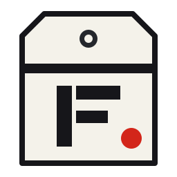

<p align="center">
  
</p>

<h1 align="center">Firedrill Drill Hub</h1>

<p align="center"><strong>Open, tested drills for <a href="https://github.com/sk1122/firedrill">Firedrill</a>.</strong></p>

<p align="center">
  <a href="https://github.com/sk1122/firedrill-drills/actions/workflows/ci.yml"></a>
  <a href="LICENSE"></a>
  <a href="https://sk1122.github.io/firedrill-drills/"></a>
</p>

<p align="center"></p>

Browse every drill at **[sk1122.github.io/firedrill-drills](https://sk1122.github.io/firedrill-drills/)**. Each drill checks that one company safeguard actually holds, against real systems, read-only, and ships with passing, failing and not-applicable test cases.

## Use a drill

```bash
firedrill hub search branch protection
```

```bash
firedrill hub add change/no-force-push-main
```

`hub add` copies the drill into `.firedrill/drills/` and records where it came from in `.firedrill/hub.lock`. Review the file and commit both. Drills are YAML with named facts and CEL conditions: they cannot run code, and every call Firedrill makes for them is read-only.

To pick up changes later:

```bash
firedrill hub update
```

It shows the difference for each drill that changed in the hub and asks before replacing it. A drill you edited is left alone unless you pass `--force`. New drills in the official packs are offered too.

## What is here

| Path | What it holds |
| --- | --- |
| `drills/<pack>/<slug>.drill.yaml` | One drill |
| `drills/<pack>/<slug>.test.yaml` | Its test cases: the fact values for each setup and the verdict they must give |
| `hub.yaml` | The hub's name and its official packs, maintained with Firedrill |
| `template/` | A drill and test file to start from |

The official packs are Firedrill's own starter drills, plus checks ported from open projects such as OpenSSF's SCM best practices and Turbot's compliance mods; each ported drill names its upstream check in `source`. Everything else comes from contributors. See [CONTRIBUTING.md](CONTRIBUTING.md) to add one.

## License

Apache-2.0. Contributions are signed off under the [Developer Certificate of Origin](https://developercertificate.org/).
